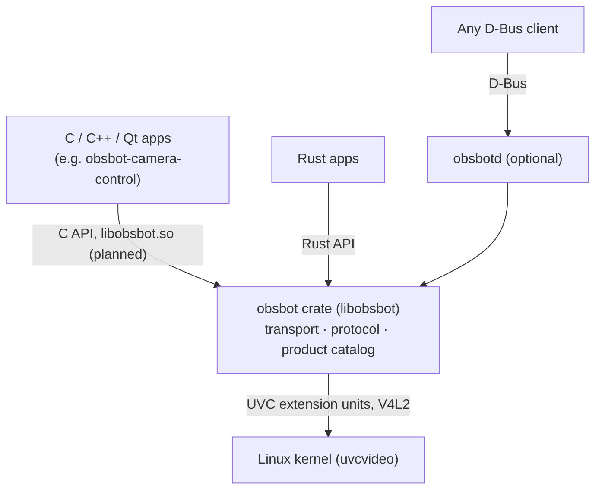

# libobsbot

An open-source Linux library for controlling OBSBOT cameras, written to replace OBSBOT's closed SDK library, `libdev`.

> **Status: scaffold.** The Rust workspace compiles, but nothing talks to a camera yet. The sections below mark what exists today and what is planned.

## Why replace the vendor library

OBSBOT's Linux SDK is a single closed library, `libdev.so`, of about 25 MB. Its own debug information lists the 76 source files built into it. Only 16 of them, in its `dev/` module, control cameras. The rest is code that a desktop application doesn't need: firmware packaging and delta patching, bzip2 and LZMA compression, an MTP file-transfer stack, an FTP client, a reliable-UDP transport and Wi-Fi discovery. All of it is linked statically, so an application that wants to set the zoom loads all of it.

Two of the bundled projects, android-file-transfer-linux and ftplibpp, are LGPL-2.1 libraries. `libdev` ships without their licence texts or any notice. The evidence, and the commands to reproduce it, are in [`docs/compliance/`](docs/compliance/).

libobsbot implements only the camera control, in the open, under the MIT licence, with every dependency pinned and its licence recorded.

## What the workspace contains

| Crate | What it is | Status |
|---|---|---|
| `obsbot` | The library, built as `libobsbot`: transport, protocol and product catalog | scaffold |
| `obsbotctl` | A command-line tool that uses the library directly | scaffold |
| `obsbotd` | An optional D-Bus daemon, for setups that want one service to own the cameras. Nothing else depends on it, since not every distribution wants a system daemon | scaffold |

Applications use the library in one of three ways:

[`docs/architecture.md`](docs/architecture.md) describes the layers.

## How the replacement is built and checked

The work has three parts.

1. **Map the vendor library.** A tool reads `libdev`'s debug information and records where each source file came from: OBSBOT's own code, or a named open-source project, with its version and licence. That map shows which parts must be reimplemented and which are generic libraries. *Status: the source-file list has been extracted by hand; the tool is planned.*
2. **Implement camera control from scratch.** The library implements only what the vendor's `dev/` module does for USB cameras. Where it needs a generic library, it takes the maintained upstream version through Cargo, pinned in `Cargo.lock`, with licences checked by `cargo-deny` and notices generated by `cargo-about`. *Status: planned.*
3. **Compare against the vendor library.** For each scenario, such as "set zoom to 2×" or "enable face tracking", a harness records the requests the vendor library sends to the camera and the camera's replies. The test suite replays these recordings against libobsbot and checks that it sends the same requests. The recordings are committed, so the tests run without the vendor SDK. *Status: planned.*

The investigation does not decompile the vendor library. It uses the library's symbol table, strings and debug information, and observes what the library sends to hardware we own. Every claim in the investigation notes comes with the shell command that reproduces it.

## The vendor SDK is not included

This repository contains no OBSBOT code, and libobsbot neither links nor loads `libdev`. You need the vendor SDK only to record new expected outputs, or to compare a libobsbot build against the vendor library directly.

To do either, get the SDK from OBSBOT through the application form at [obsbot.com/sdk](https://www.obsbot.com/sdk) and keep it outside this repository. The planned tooling looks for it in `$OBSBOT_SDK_DIR`, by default `~/.local/share/libobsbot/sdk/<package>/`, and refuses any file whose SHA256 does not match a pinned version:

| SDK package | Library file | SHA256 |
|---|---|---|
| `libdev_v2.1.0_7` | `libdev.so.1.0.2` | `d9fc9cd7f6743a3eefd50dbae104ccaff9c3d45ee37816722cb0bd683854e7a4` |
| `libdev_v2.1.0_8` | `libdev.so.1.0.0` | `3eef907f5eec5cc4ee3d3df3a89cd736458bf48f815612b6bed879ea62b08c55` |

The library's own version numbers go backwards between these packages, so a pin always names the package and the hash.

## Camera coverage

The vendor library's header names 17 products, from the Tiny and Meet lines to the Tail and the HDMI and NDI boxes, and the library also recognises at least one it doesn't name: the Meet Flip, which reports as product type 25. The project has one camera, a Meet 2, which is the reference device.

Support for each camera and each control carries an evidence grade, strongest first:

1. **Hardware-verified**: tested on the camera itself.
2. **Owner-captured**: recorded from a contributor's camera.
3. **Vendor-oracle**: recorded from the vendor library talking to a simulated camera that identifies as that product. This shows what the vendor library sends, not how the camera responds.
4. **Vendor-documented**: stated only in the vendor's header file.

A camera's support claim names its grade. [`docs/devices.md`](docs/devices.md) lists the catalog. If you own an OBSBOT camera other than the Meet 2, recordings from it are the most useful contribution you can make.

## Scope

In scope: pan, tilt and zoom, focus, exposure, white balance, HDR, the AI modes (tracking, auto-framing, gestures, presets), device events, and a capability profile for each product.

Out of scope for now:

- Firmware upgrade.
- Virtual-background upload, which uses MTP.
- Tail Air networked and wireless streaming.
- Video. The kernel's UVC driver already exposes each camera as `/dev/videoN`; read frames with GStreamer, V4L2 or OpenCV.

## Related projects

- [obsbot-camera-control](https://github.com/aaronsb/obsbot-camera-control): a Qt application for OBSBOT cameras. It uses the vendor SDK today and is developed alongside libobsbot, which it will move to.
- [bosectl](https://github.com/aaronsb/bosectl): the same Linux-native approach applied to Bose headphones.

## License

MIT. See [LICENSE](LICENSE).
